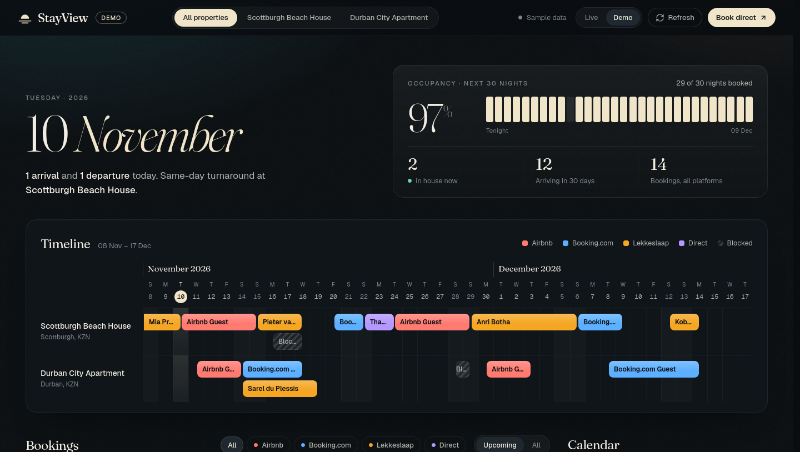

# StayView — Rental Dashboard

A self-hosted dashboard that aggregates bookings from **Airbnb**, **Booking.com** and **Lekkeslaap** into one place. Accept direct bookings commission-free. Built with vanilla JS and a lightweight Node.js server — no framework, no database, no npm dependencies.

[](https://stayview.onrender.com)
[](LICENSE)
[](https://github.com/louisnelza/stayview/releases)



## Live Demo

👉 [stayview.onrender.com](https://stayview.onrender.com) — click **Demo** in the header to see sample data without any credentials.

## Features

- **Multi-platform** — Airbnb, Booking.com and Lekkeslaap iCal feeds in one view
- **Multi-property** — manage multiple rentals from one dashboard with a property switcher
- **Direct booking engine** — guest-facing `/book` page so guests can book without platform commissions
- **Manual booking capture** — add walk-in or phone bookings directly to the dashboard
- **Today briefing** — a one-line summary of today's arrivals, departures and same-day turnarounds
- **Stay timeline** — one row per property, one bar per stay, colour-coded by platform; click a bar to jump to its booking
- **Calendar view** — colour-coded by platform with turnaround day indicators
- **Granular booking status** — Arrives today / In house / Leaves today / In N days / Past
- **Turnaround reminders** — banners and calendar dots for checkout days, same-day swaps (one guest leaves, the next arrives) and arrivals soon after a checkout, tracked per property ([details](#turnaround-reminders))
- **Occupancy stats** — night-by-night occupancy strip for the next 30 days, guests in house, upcoming arrivals and turnarounds this month
- **Platform filters** — only shows filters for platforms you have configured, plus direct bookings
- **Auto-refresh** — server-side polling keeps data current without manual refresh
- **Platform downtime resilience** — cached iCal data served when a platform is temporarily unavailable
- **Lekkeslaap guest details** — reference number, email, cell and supplier link on booking cards
- **Provisional booking detection** — flags Lekkeslaap bookings awaiting confirmation
- **Demo mode** — realistic sample data, works without any credentials
- **Self-hosted** — runs on a Raspberry Pi, no cloud subscription required

## Getting Started

### 1. Clone the repo

```bash
git clone https://github.com/louisnelza/stayview.git
cd stayview
```

### 2. Configure your iCal URLs

Copy the example env file and fill in your iCal URLs:

```bash
cp .env.example .env
```

Edit `.env` — multi-property format (recommended):

```
PROPERTY_1_NAME=Scottburgh Beach House
PROPERTY_1_LOCATION=Scottburgh, KwaZulu-Natal
PROPERTY_1_AIRBNB=https://www.airbnb.com/calendar/ical/YOUR_ID.ics?t=YOUR_TOKEN
PROPERTY_1_BOOKING=https://ical.booking.com/v1/export?t=YOUR_TOKEN
PROPERTY_1_LEKKESLAAP=https://www.lekkeslaap.co.za/suppliers/icalendar.ics?t=YOUR_TOKEN
PROPERTY_1_NIGHTLY_RATE=1200
PROPERTY_1_CURRENCY=ZAR
PROPERTY_1_MIN_NIGHTS=2
PROPERTY_1_MAX_GUESTS=8
PROPERTY_1_TURNAROUND_GAP_DAYS=3

# Add a second property by uncommenting and filling in:
# PROPERTY_2_NAME=Durban City Apartment
# PROPERTY_2_AIRBNB=
# PROPERTY_2_BOOKING=
# PROPERTY_2_LEKKESLAAP=

POLL_INTERVAL_MINUTES=120
```

Legacy single-property format still works too — see `.env.example` for details.

#### Turnaround reminders

The dashboard marks the days a unit needs attention between guests, with a dot on the calendar and a banner above the booking on the day:

| Reminder | When it appears |
|---|---|
| **Same-day turnaround** | One guest checks out and the next checks in on the same day |
| **Checkout today** | A guest checks out and nobody arrives that day — clean and prepare the unit |
| **New guest arriving** | A guest checks in a few days after the previous checkout — confirm the unit is still serviced and ready |

How many days counts as "a few" is the **turnaround gap**, set per property with `PROPERTY_1_TURNAROUND_GAP_DAYS`, `PROPERTY_2_TURNAROUND_GAP_DAYS` and so on (`TURNAROUND_GAP_DAYS` in the single-property format). With the default of 3, an arrival up to 3 days after a checkout gets the reminder; a longer gap does not. Use a smaller number for a unit that stays clean when empty, a larger one for a unit that needs airing or a top-up clean after standing empty for a while, or 0 to turn this reminder off. Whole numbers from 0 to 30 are accepted; anything else falls back to 3. The other two reminders always appear. After changing the gap, reload the dashboard page — the Refresh button re-fetches calendars but not settings.

The **Turnarounds this month** figure counts all three kinds for the current calendar month, for the property selected in the switcher.

> Your `.env` file is listed in `.gitignore` and will never be committed.

### 3. Run

```bash
node server.js
```

Open `http://localhost:3456` in your browser.

## Direct Booking Engine

Guests can book directly at `http://your-server:3456/book` without going through a platform.

To manually capture a walk-in or phone booking, add an entry to `bookings.json` in the same folder as `server.js`:

```json
[
  {
    "uid": "direct-1234567890",
    "source": "direct",
    "name": "Guest Name",
    "email": "guest@email.com",
    "phone": "+27821234567",
    "guests": 2,
    "checkin": "2026-08-01",
    "checkout": "2026-08-05",
    "nights": 4,
    "total": 4800,
    "currency": "ZAR",
    "status": "confirmed",
    "created": "2026-07-17T08:00:00.000Z"
  }
]
```

Click **Refresh** in the dashboard header to load the new booking. Direct bookings appear in purple and can be deleted from the dashboard with the bin button on their card.

## Where to find your iCal URLs

| Platform | Location |
|---|---|
| **Airbnb** | Calendar → Availability settings → Export calendar |
| **Booking.com** | Property → Calendar → Export calendar |
| **Lekkeslaap** | Supplier dashboard → Calendar → iCal export |

## Deploying to a Raspberry Pi

Run StayView as a systemd service so it starts on boot and is restarted automatically if it ever stops.

### 1. Install Node.js and get the code

```bash
sudo apt update && sudo apt install -y nodejs git
git clone https://github.com/louisnelza/stayview.git ~/stayview
cd ~/stayview
cp .env.example .env   # then add your iCal URLs
```

StayView needs Node.js 18 or newer — check with `node --version`.

### 2. Edit the service file

The repo includes `stayview.service`:

```ini
[Unit]
Description=StayView rental dashboard
After=network-online.target
Wants=network-online.target

[Service]
Type=simple
User=pi
WorkingDirectory=/home/pi/stayview
ExecStart=/usr/bin/node /home/pi/stayview/server.js
Restart=always
RestartSec=5

[Install]
WantedBy=multi-user.target
```

Change three things to match your Pi:

- `User` — the account that owns the `stayview` folder (run `whoami`)
- `WorkingDirectory` and the path in `ExecStart` — where you cloned the repo
- `/usr/bin/node` — the output of `which node`

### 3. Install and start it

```bash
sudo cp stayview.service /etc/systemd/system/
sudo systemctl daemon-reload
sudo systemctl enable --now stayview
```

`enable` makes it start on every boot; `--now` also starts it straight away. Open `http://<your-pi-address>:3456` from any device on the same network.

### How it stays alive

- **On boot** — `WantedBy=multi-user.target` starts the service whenever the Pi powers up, and `After=network-online.target` waits for the network so the first calendar fetch can succeed.
- **After a crash** — `Restart=always` brings the server back five seconds (`RestartSec=5`) after it exits for any reason.
- **After a power cut** — nothing to do; the Pi boots and the service starts itself.

### Day-to-day commands

```bash
systemctl status stayview          # is it running?
journalctl -u stayview -f          # follow the logs
sudo systemctl restart stayview    # restart after changing .env or updating
sudo systemctl stop stayview       # stop it
sudo systemctl disable stayview    # stop it starting on boot
```

To update to a newer version:

```bash
cd ~/stayview && git pull && sudo systemctl restart stayview
```

## Deploying to Render (live URL)

[](https://render.com/deploy)

1. Go to [render.com](https://render.com) and sign in with GitHub
2. **New → Web Service → Connect** your `stayview` repo
3. Settings:
   - **Runtime**: Node
   - **Build command**: *(leave empty)*
   - **Start command**: `node server.js`
4. Under **Environment**, add your property variables (e.g. `PROPERTY_1_NAME`, `PROPERTY_1_AIRBNB` etc.)
5. Click **Deploy**

> Render's free tier spins down after inactivity — first load may take ~30 seconds. Fine for a demo, use a paid tier for production.

## Running as an Executable (no Node.js required)

Download the latest release for your platform from [Releases](https://github.com/louisnelza/stayview/releases):

| File | Platform |
|---|---|
| `stayview-win.exe` | Windows |
| `stayview-macos` | macOS |
| `stayview-linux` | Linux |

Place the executable and `config.txt` in the same folder. Edit `config.txt` with your iCal URLs, then double-click (Windows) or run from terminal (Mac/Linux).

See `SETUP.md` for detailed instructions.

### Building the executables from source

The release files are built with [pkg](https://github.com/vercel/pkg), which is the project's only dev dependency:

```bash
npm install      # installs pkg
npm run build    # writes the three executables to dist/
```

This produces `dist/stayview-win.exe`, `dist/stayview-macos` and `dist/stayview-linux`.

## Runtime Files

These files are created automatically and are listed in `.gitignore`:

| File | Contents |
|---|---|
| `.env` | Your private iCal URLs and config |
| `config.txt` | Same as `.env` but for executable users |
| `bookings.json` | Direct bookings made through `/book` or manually added |
| `ical-cache.json` | Cached iCal data — serves stale data during platform outages |
| `known-uids.json` | Booking UIDs already seen per source — used to detect new bookings |

## Stack

- **Frontend**: Vanilla HTML/CSS/JS, Geist + Geist Mono fonts (loaded from Google Fonts)
- **Backend**: Node.js built-in `http` / `https` modules — zero npm dependencies
- **Hosting**: Raspberry Pi with systemd, any Node.js host, or packaged executable
- **Config**: `.env` file (developers/Pi) or `config.txt` (executable users)